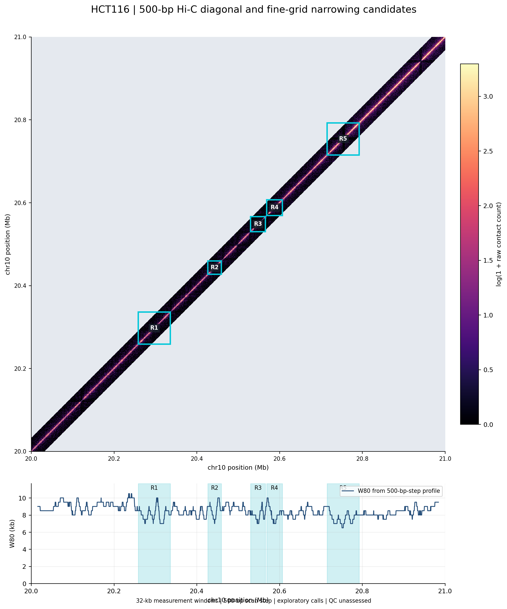
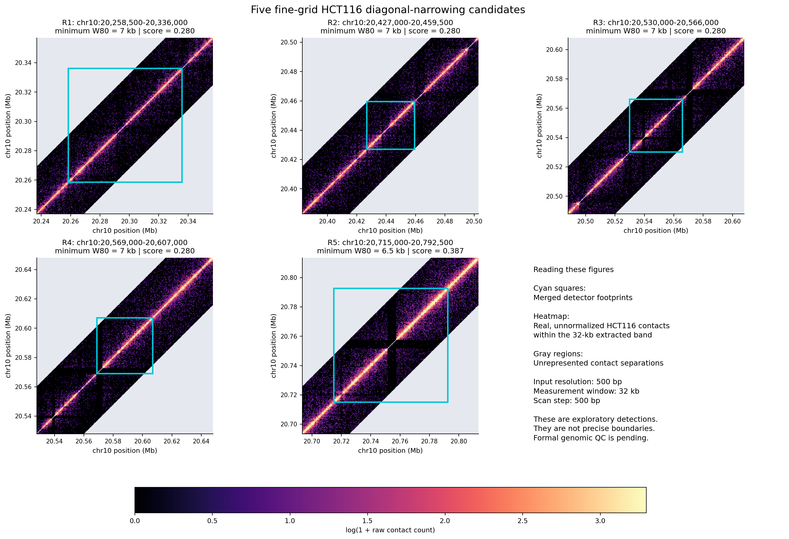

# Stage 1: High-resolution Hi-C diagonal narrowing detection

- **Researcher:** Grold Otieno Mboya
- **Affiliation:** Fatima Institute for Global AI Research
- **Supervisor:** Dr. Muhammad Shamim
**Status:** Exploratory Stage 1 implementation and demonstration.
Formal genomic QC and biological validation remain outstanding.

## 1. Objective

Develop a working detector of local reductions in Hi-C diagonal
width and demonstrate its results using high-resolution contact
maps, genomic coordinates, narrowing scores, and quality measures.

This document accompanies the computational outputs. It does not
claim that the detected regions have established biological significance.

## 2. Dataset and method

- Dataset: HCT116 Hi-C, ENCODE ENCSR477GZK.
- Reference genome: GRCh38.
- Demonstration region: chr10:20,000,000–21,000,000.
- Input contact-map resolution: **500 bp**.
- Contact normalization: NONE; raw contact counts.
- Local measurement window: **32 kb**.
- Maximum analyzed genomic separation: **32 kb**.
- Fine scan step: **500 bp**.
- Genomic intervals: zero-based, half-open.
- Contact assignment: by genomic pair midpoint.
- W80: smallest contact separation accumulating 80% of the
  distance-normalized off-diagonal contact intensity.
- Narrowing score: log2(reference median W80 / target W80).
- Exploratory call threshold: score greater than 0.2.

The fine scan contains 1,937 overlapping windows.
Every 16th window reproduces the original 122-window profile,
including W80 and contact-support measurements.

The scan step must not be interpreted as boundary precision.

## 3. Example candidate output

Five merged exploratory regions were obtained from 93 called
overlapping windows.

All coordinates below are on chromosome 10.

| Region | Footprint (bp) | Peak W80 (kb) | Peak score | Called windows | Peak-score ties | Bin-support observation |
|---|---|---:|---:|---:|---:|---|
| R1 | 20,258,500–20,336,000 | 7 | 0.2801 | 23 | 23 | None in representative window |
| R2 | 20,427,000–20,459,500 | 7 | 0.2801 | 2 | 2 | None in representative window |
| R3 | 20,530,000–20,566,000 | 7 | 0.2801 | 8 | 8 | 1 zero-contact bins |
| R4 | 20,569,000–20,607,000 | 7 | 0.2801 | 11 | 11 | None in representative window |
| R5 | 20,715,000–20,792,500 | 6.5 | 0.3870 | 49 | 7 | 6 zero-contact bins |

These footprints are unions of called 32-kb measurement windows.
They are not inferred chromatin boundary coordinates.

The narrowing score is descriptive, not a calibrated p-value
or probability of biological significance.

### Full machine-readable outputs

- `research_artifacts/stage1/hct116_stage1_500bp_step_calls.csv`:
  all 93 individual candidate windows.
- `research_artifacts/stage1/hct116_stage1_candidate_deliverable_v1.csv`:
  five merged regions, scores, support metrics, and QC annotations.
- `research_artifacts/stage1/hct116_stage1_500bp_step_scored.csv`:
  all 1,937 windows with detector scoring.
- `research_artifacts/stage1/hct116_stage1_fine_step_quality_summary.csv`:
  contact support and tied-peak ambiguity.
- `research_artifacts/stage1/hct116_stage1_zero_bin_sensitivity.csv`:
  targeted zero-contact-bin exclusion sensitivity.

## 4. Real Hi-C contact-map figures

### Full-region map and W80 track



### Five candidate-region contact maps



PDF versions are available alongside the PNG figures in
`figures/stage1/`.

The contact maps show actual extracted HCT116 contact records.
The extraction includes off-diagonal separations up to 32 kb.
Gray map areas denote unrepresented separations, not biological
absence of contacts.

The highlighted regions indicate detector footprints rather
than exact biological boundaries.

## 5. Quality assessment and limitations

The current outputs include observed contact counts, pair
occupancy, observed distance-band support, bin-level endpoint
support, and the number of equally scoring peak windows.

A descriptive control comparison used 21 non-overlapping
reference windows outside candidate footprints. A separate
interior per-bin assessment used 19 control windows. These
were not coverage-matched controls.

R3 contained one zero-contact bin in its representative
peak window. R5 contained six, including a run of three.
Excluding those particular bins and recalculating the
distance-specific eligible-pair denominators left the
representative W80 measurements unchanged for all five
regions.

This sensitivity result does not exclude other coverage
or mapping artifacts.

**Outstanding limitations:**

- Formal missing-bin validity masks have not been established.
- Genomic QC thresholds have not been calibrated.
- The original demonstration uses one pooled HCT116 data product;
  independent biological replicate validation is not shown here.
- Results at 200-bp and 100-bp resolutions have not been demonstrated.
- A 500-bp scan step does not imply 500-bp localization accuracy.
- Aggregate and biological validation belong to later stages.

All five candidates therefore retain `formal_qc_status=unassessed`.

## 6. Code and usage

Repository:
https://github.com/Grolds-Code/hic-diagonal-narrowing

The detector implementation is in
`src/hic_diagonal_narrowing/detect.py`.

Local fine-grid analysis scripts:

- `stage1_fine_step_detect.py`
- `stage1_fine_step_quality_summary.py`
- `stage1_compile_candidate_table.py`

Modal analysis scripts:

- `modal_hct116_fine_step_profile.py`
- `modal_hct116_fine_scan_figures.py`
- `modal_hct116_endpoint_support.py`
- `modal_hct116_zero_bin_sensitivity.py`

The Modal scripts require access to the original contact
extraction in the Modal volume
`hic-diagonal-narrowing-data`, together with Modal credentials.

To run repository unit tests:

```bash
uv run python -m unittest discover -s tests
```

The generated CSVs and figures above are included as example
outputs. Regeneration scripts intentionally refuse to
overwrite existing outputs; use a separate working copy with
the generated destinations absent when regenerating them.

## 7. Stage 1 interpretation

The implementation demonstrates working local W80 estimation,
narrowing-score calculation, genomic candidate calls, and
direct visualization against real 500-bp Hi-C contact maps.

It also documents measurement uncertainty and technical-support
limitations.

The strongest reported score belongs to R5, but the candidate
is not biologically validated. The additional regions detected
at the finer scan step require further quality assessment.

The next substantive work should focus on formal genomic QC,
sensitivity to coverage and bin validity, and eventually
matched controls and biological replicates.

**Prepared for review by Dr. Muhammad Shamim.**
